<div align="center">

<p align="center">
  
  &nbsp;&nbsp;&nbsp;&nbsp;&nbsp;
  
</p>

# NextGen ComimssionPro - Frontend

</div>

## Como rodar localmente

### Instale o NodeJs

Para rodar o projeto localmente, é necessário instalar o [NodeJs](https://nodejs.org/en/download/package-manager).

### Instale o Yarn

Recomenda-se instalar o [Yarn](https://classic.yarnpkg.com/lang/en/docs/install/#windows-stable) para gerenciar as dependências do projeto.

### Defina as variáveis de ambiente

1. Na raiz do projeto, crie um arquivo chamado `.env`.
2. Copie o conteúdo do arquivo `.env.example` para o novo arquivo `.env`.
3. Ajuste os valores das variáveis conforme o seu ambiente local.

### Instale as dependências e rode o projeto

Para instalar as dependências e iniciar o projeto, execute no terminal, na raiz do repositório:

```
yarn
yarn start
```

## Testes

### Como rodar os testes localmente

1. Certifique que o backend _não_ está rodando.
2. Abra um terminal e execute o serviço do Frontend com `yarn start`.
3. Em outro terminal, na raiz do projeto, execute `yarn cy:open`.
   Uma janela do Cypress será aberta. Nela, selecione o tipo de teste desejado e, em seguida, escolha o navegador (testado no Google Chrome).

## Documentação

### API

Para obter a cotação utilizada na criação de novos produtos ou serviços, o sistema integra-se à [AwesomeAPI](https://docs.awesomeapi.com.br/), responsável por fornecer dados de câmbio atualizados, com limite de até 10 mil requisições mensais.

### Documentação do Sistema

As regras de negócio que definem o funcionamento do sistema estão disponíveis na documentação oficial:
[Acessar Documentação](https://protectsolutionscombr.sharepoint.com/:b:/s/Onboarding/IQABou2DaVEjTYelN2-zuCayASgO_HSbUjh1EXuliCZSuVY?e=g8xQCK)

### Manual do Usuário

Consulte o manual completo para entender como utilizar o sistema conforme o papel atribuído ao usuário:
[Acessar Manual do Usuário](https://protectsolutionscombr.sharepoint.com/:b:/r/sites/Onboarding/Documentos%20Compartilhados/Processos%20Internos/7%20-%20CommissionPro/Manuais%20de%20uso/CommissionPro%20V5.0%20-%20Manual%20de%20Usu%C3%A1rio.pdf?csf=1&web=1&e=GGlJnY)

### Guia rápido

Guia rápido para começar a usar o sistema: [Acessar Guia Rápido](https://protectsolutionscombr.sharepoint.com/:b:/r/sites/Onboarding/Documentos%20Compartilhados/Processos%20Internos/7%20-%20CommissionPro/Manuais%20de%20uso/CommissionPro%20-%20Guia%20R%C3%A1pido%20V3.pdf?csf=1&web=1&e=HZIrry)
